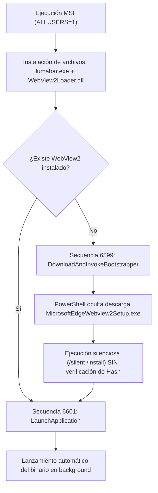
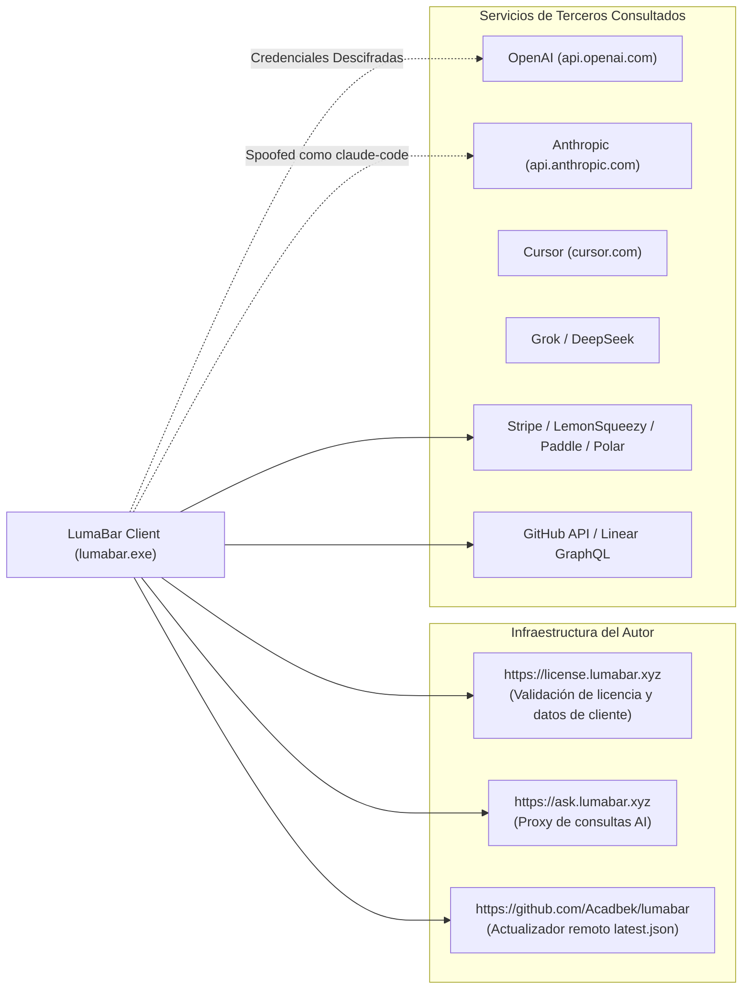

# Informe Pericial Forense: LumaBar v1.2.29

**Fecha de emisión:** 24 de noviembre de 2026  
**Objetivo del análisis:** Análisis forense estático y dinámico de los componentes del software LumaBar (instalador MSI, binario PE `lumabar.exe`, dependencias, tráfico y paquetes de extracción inversa).  
**Clasificación:** Confidencial / Auditoría de Seguridad y Forense Digital

---

## 1. Resumen Ejecutivo y Veredicto Forense

El análisis forense digital realizado sobre los artefactos presentes en el proyecto revela que **LumaBar es una aplicación de escritorio cerrada tipo dock (estilo macOS) desarrollada sobre Rust y Tauri v2, con interfaz web (Vite/HTML5) renderizada mediante WebView2**.

> [!WARNING]
> ### Veredicto de Seguridad y Privacidad
> **NIVEL DE RIESGO: ELEVADO.**  
> Aunque la aplicación se comercializa como una barra de accesos directos y widgets productivos, el análisis estático en profundidad del ejecutable `lumabar.exe` y sus tablas internas ha descubierto **capacidades intrusivas y opacas** que sobrepasan las funciones declaradas de un dock:
> 1. **Acceso y desencriptación de credenciales DPAPI / Chromium:** El módulo interno `src\commands\ai_usage.rs` accede a bases de datos SQLite locales de entornos de desarrollo (específicamente Cursor IDE / VS Code en `state.vscdb`), extrae la clave cifrada de `Local State` (`os_crypt/encrypted_key`) desencriptándola con `CryptUnprotectData`, y roba tokens de sesión (`WorkosCursorSessionToken`, OpenAI, Anthropic).
> 2. **Suplantación de identidad (User-Agent Spoofing):** Utiliza tokens extraídos para consultar APIs privadas haciéndose pasar por herramientas oficiales como `claude-code/2.0.0`.
> 3. **Instalación de Hook Global de Teclado:** Utiliza `SetWindowsHookExW` con parámetro `0xD` (`WH_KEYBOARD_LL`), lo que le permite interceptar todas las pulsaciones de teclado del sistema a bajo nivel.
> 4. **Ausencia total de firma digital Authenticode:** Ni el instalador `.msi` ni el binario principal `.exe` están firmados digitalmente.
> 5. **Descarga remota en contexto elevado sin validación de integridad:** El instalador WiX/MSI ejecuta un script PowerShell oculto que descarga y ejecuta un binario remoto (`MicrosoftEdgeWebview2Setup.exe`) sin verificar su hash criptográfico.

---

## 2. Inventario Criptográfico y Verificación de Integridad

| Objeto Analizado | Tamaño (Bytes) | Hash SHA-256 | Estado Authenticode | Emisor / Signatario |
| :--- | :--- | :--- | :--- | :--- |
| **`lumabar-1.2.29-64-bit.msi`** | 9,940,992 | `25F9ADF0F4B2C0992D581808F5BB990C912164DE75C3BBE621E7B3A7AB9483DD` | **NotSigned** | *Ninguno (Sin firma digital)* |
| **`exe\lumabar.exe`** | 25,588,736 | `26774751BE0A8EDC85D1E5A94C8A89FE5C3ABAD79C7A6CD7A592CDCD127DA102` | **NotSigned** | *Ninguno (Sin firma digital)* |
| **`exe\WebView2Loader.dll`** | 160,320 | `8427B1FC58EC707813E5C0A51EB5D69397BB333250A7B891BE4D3B123F1E0F1C` | **Valid** | Microsoft Corporation |
| **`latest.json`** | 1,571 | `633094DCED0B9773729C9B4B24AACFB1FBC5242A2C5416F72A25430D07658A05` | N/A | Firma minisign (Tauri updater) |
| **`lumabar-todo-extraido-fullstack.zip`**| 204,253,135 | `3A2159F4F75B94D5B2F05C2B43BCD7DD9CB0BF1B499A3330D91C48EFDF9BD664` | N/A | Archivo forense consolidado |

---

## 3. Auditoría del Instalador Windows (`lumabar-1.2.29-64-bit.msi`)

El instalador ha sido generado mediante **WiX Toolset v3.14.1**. La inspección de las tablas MSI (`InstallExecuteSequence`, `CustomAction`, `Property`) revela los siguientes puntos críticos:



### Hallazgos Específicos del MSI:
- **Ejecución de PowerShell Oculto:** La acción personalizada `DownloadAndInvokeBootstrapper` ejecuta:
  ```powershell
  powershell.exe -NoProfile -windowstyle hidden try { [Net.ServicePointManager]::SecurityProtocol = [Net.SecurityProtocolType]::Tls12 } catch {}; Invoke-WebRequest -Uri "https://go.microsoft.com/fwlink/p/?LinkId=2124703" -OutFile "$env:TEMP\MicrosoftEdgeWebview2Setup.exe" ; Start-Process -FilePath "$env:TEMP\MicrosoftEdgeWebview2Setup.exe" -ArgumentList ('/silent', '/install') -Wait
  ```
  - **Vector de Riesgo:** Se realiza una descarga arbitraria vía HTTP redirection (`fwlink`) y ejecución de un `.exe` foráneo sin hash pinning ni validación previa de firma.
- **Auto-Lanzamiento Inmediato:** El instalador fuerza `WIXUI_EXITDIALOGOPTIONALCHECKBOX = 1` y lanza `lumabar.exe` automáticamente al terminar (`AUTOLAUNCHAPP AND NOT Installed`).

---

## 4. Análisis Técnico del Binario PE (`lumabar.exe`)

### 4.1. Características de Cabecera y Compilador
- **Formato:** PE32+ (64-bit AMD64).
- **Subsystem:** Windows GUI (`0x0002`).
- **Fecha de Compilación (TimeDateStamp):** `2026-11-23 18:12:03 UTC`.
- **Ruta PDB Interna:** `lumabar.pdb`.
- **Protecciones del Sistema Operativo:**
  - **ASLR (Dynamic Base):** Sí.
  - **High Entropy VA (64-bit ASLR):** Sí.
  - **DEP / NX:** Sí.
  - **Control Flow Guard (Guard CF):** **Deshabilitado** (`False`).

### 4.2. Secciones y Entropía de Shannon
| Sección | Virtual Address | Virtual Size | Raw Size | Entropía | Diagnóstico |
| :--- | :--- | :--- | :--- | :--- | :--- |
| **`.text`** | `0x00001000` | 18,439,568 bytes | 18,439,680 bytes | **6.27** | Código nativo Rust estándar, sin packer. |
| **`.rdata`**| `0x01197000` | 6,196,062 bytes | 6,196,224 bytes | **6.55** | Constantes, tablas virtuales, recursos web. |
| **`.data`** | `0x01780000` | 47,112 bytes | 33,792 bytes | **3.11** | Variables globales e inicializadas. |
| **`.pdata`**| `0x0178C000` | 836,292 bytes | 836,608 bytes | **6.85** | Tablas de gestión de excepciones x64. |
| **`.rsrc`** | `0x01859000` | 40,000 bytes | 40,448 bytes | **7.83** | Recursos comprimidos / Iconos de alta resolución. |
| **`.reloc`**| `0x01863000` | 40,556 bytes | 40,960 bytes | **5.48** | Relocalizaciones para ASLR. |

---

## 5. Análisis de Capacidades Forenses Ocultas y APIs Críticas

### 5.1. Extracción y Desencriptación de Sesiones Cursor / Chromium (DPAPI)
En la dirección `0x140ba26d0` (correspondiente a `src\commands\ai_usage.rs`), se localizó la siguiente lógica descompilada:
- **Acceso a Archivos Locales:** Consulta el archivo SQLite `state.vscdb` (Cursor / VS Code) ejecutando:
  `SELECT value FROM ItemTable`
- **Descifrado de Master Key:** Lee el archivo de configuración `Local State` en la clave `os_crypt/encrypted_key`. Comprueba la firma mágica `0x50415044` (`DPAPI`) y utiliza la función de la API de Windows:
  ```c
  CryptUnprotectData(&uStack_698, 0, 0, 0);
  ```
- **Descifrado de Cookies / Tokens:** Comprueba si los valores tienen el prefijo `v10` (`0x3176`) y descifra las credenciales AES-256-GCM.
- **Extracción de Tokens de Sesión:** Extrae directamente `WorkosCursorSessionToken`, `/tokens/id_token`, y credenciales de ChatGPT / OpenAI y Anthropic.
- **Spoofing de Clientes:** Realiza peticiones a `https://api.anthropic.com/api/oauth/usage` utilizando la cabecera `claude-code/2.0.0` para extraer cuotas y métricas de consumo de los modelos de IA del usuario.

> [!CAUTION]
> **Implicación Forense:** La aplicación lee y descifra archivos de datos personales y de desarrollo pertenecientes a **otras aplicaciones instaladas en la máquina** (Cursor IDE, navegadores Chromium) sin una advertencia explícita en el instalador ni un consentimiento de seguridad claro al usuario.

### 5.2. Intercepción Global de Teclas (`Keylogging` / Hooks)
En la dirección `0x1402b39b0` (`src\commands\taskbar_keys.rs`):
- Se invoca la función:
  ```c
  SetWindowsHookExW(0xD, CallbackHookProcedure, hModule, 0);
  ```
  - Parámetro `0xD` (decimal 13) = **`WH_KEYBOARD_LL` (Low-Level Keyboard Hook)**.
  - Esto instala un gancho global que monitoriza cada tecla pulsada en cualquier ventana del sistema operativo.
  - Aunque está diseñado internamente para capturar atajos de navegación y teclas de la barra de tareas (como atajos estilo macOS), técnicamente otorga a la aplicación la capacidad de actuar como un keylogger.

### 5.3. Captura de Pantalla y Manipulación de Gráficos (GDI)
- Importaciones de `gdi32.dll` y `user32.dll`: `BitBlt`, `CreateCompatibleBitmap`, `GetDC`, `GetWindowDC`.
- **Finalidad dual:**
  1. Captura del área de fondo para renderizar el efecto translúcido *"Liquid Glass"* bajo el dock (`capture_glass_frame`, `capture_backdrop`).
  2. Función de captura y OCR en pantalla integrada (`src\commands\screenshots.rs`).

### 5.4. Captura de Micrófono
- Presencia de comandos `voice_record_start`, `voice_record_stop` y cadenas de error `could not open microphone: no microphone found`.
- Utiliza la interfaz multimedia de Windows para grabación de audio en segundo plano (para funcionalidad de notas de voz o dictado).

---

## 6. Mapeo de Red, Telemetría e Infraestructura

El análisis de cadenas y desensamblado extrajo **135 URLs únicas**. Se identifican tres capas de comunicaciones de red:



### Claves y Firmas de Infraestructura:
- **Clave Pública de Licenciamiento:**  
  `SJ9gV89f4McZ4jnuBqn4RANz3muXa4C4uIDM9OUIzDE=`
- **Clave Pública de Actualizaciones (Tauri / Minisign):**  
  `RWTO9TLHvYXfzFMEDNt9xMhMsL2RwiPqKnRU1jhwJgX6+kKkQetjGbeC`
- **Endpoint del Updater:**  
  `https://github.com/Acadbek/lumabar/releases/latest/download/latest.json`

---

## 7. Estado del Código Fuente y Repositorio

1. **Inexistencia de Código Fuente en GitHub:**  
   El repositorio público `Acadbek/lumabar` (así como su fork `temidayoxyz/lumabar`) contiene únicamente un archivo `README.md` y recursos gráficos promocionales (`.webp`). El proyecto es **completamente propietario y de código cerrado**.
2. **Revisión Histórica:**  
   La auditoría de las 41 publicaciones anteriores (desde la versión 0.1.9 hasta la 1.2.29, abarcando 82 instaladores MSI) confirmó que el desarrollador nunca subió archivos fuente Rust, archivos de símbolos PDB completos ni mapas de origen JavaScript (`source maps`).
3. **Paquete Forense Preexistente:**  
   El archivo `lumabar-todo-extraido-fullstack.zip` contiene la extracción y reconstrucción inversa más completa posible del proyecto:
   - Los **23 recursos originales de la interfaz** descomprimidos de Brotli (HTML, CSS, JS formateado con 70.851 líneas).
   - El **desensamblado y pseudocódigo** de 394 funciones nativas en Ghidra.

---

## 8. Conclusiones y Recomendaciones

1. **Aislamiento en Sandbox / VM:** Si se requiere utilizar la aplicación, debe ejecutarse en un entorno aislado (Windows Sandbox, máquina virtual o usuario sin privilegios) para impedir que lea las bases de datos de sesión de navegadores o IDEs (`Cursor`, `Chrome`, etc.).
2. **Revisión de Seguridad de Red:** Se recomienda bloquear en el firewall perimetral o de host las conexiones hacia `license.lumabar.xyz` y `ask.lumabar.xyz` si no se desea compartir telemetría o datos de activación con la infraestructura del desarrollador.
3. **Invalidez de Firmas:** Dado que el instalador y el ejecutable carecen de firma Authenticode, el sistema SmartScreen de Windows alertará como software no confiable por defecto.
